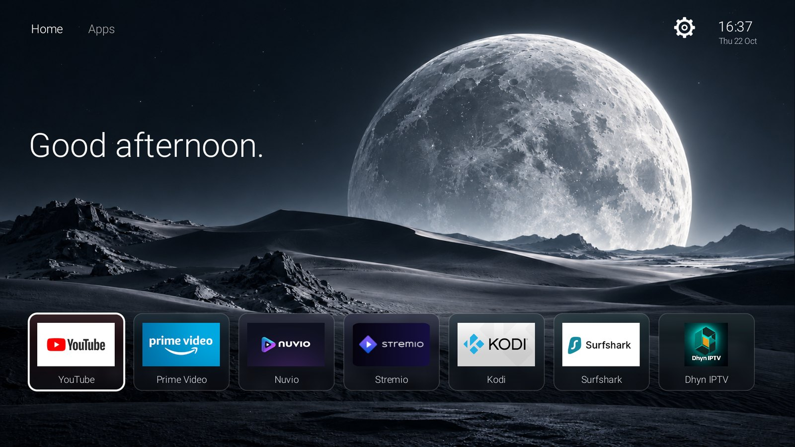
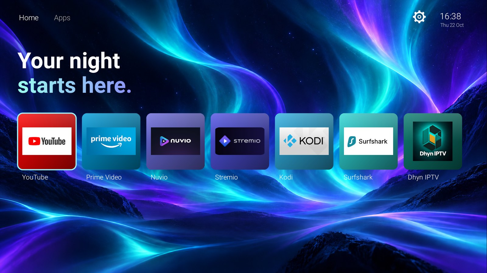
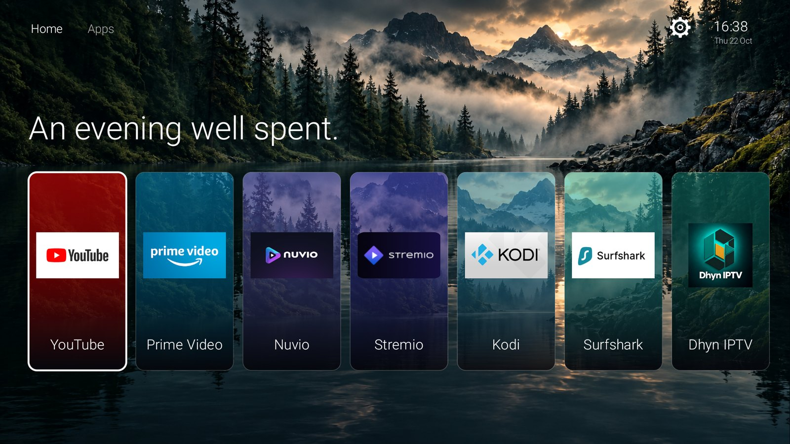
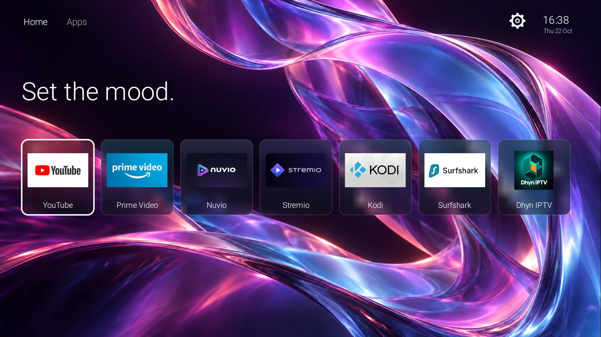
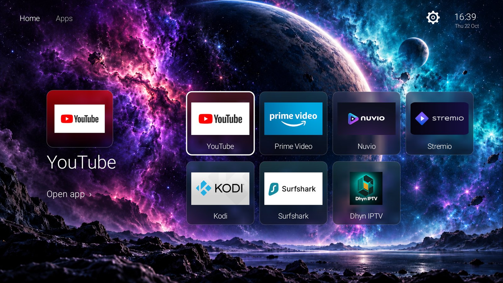

# Luma

A calm, good-looking home screen for Fire TV and Android TV. Your seven favourite apps sit in a
dock over a full-screen wallpaper, with an "All apps" grid, five themes and quick access to the
TV's settings. No ads, no rows of recommendations.

| Aurora | Cinema Shelf |
|---|---|
|  |  |
| **Prism** | **Nebula** |
|  |  |

*Screenshots from a Fire TV. The apps shown are the ones installed on that TV; their names and artwork belong to their owners.*

- **Five themes:** Lunar, Aurora, Cinema Shelf, Prism and Nebula, each with its own wallpaper and
  card style: frosted glass, glossy tiles or scenic posters.
- **Cards made from your apps:** each card uses the app's own TV banner or icon, tinted to match.
- **Built for the remote:** a crisp highlight that moves straight to the tile you press, Hold OK to rearrange, Luma-styled menus.
- **Settings in one place:** the gear opens Luma Settings (Appearance, TV settings, About).
- **Screen-reader friendly:** every tile, menu row and top-bar item is labelled.
- **Small and private:** no internet access, no permissions, no tracking. About 11 MB.

## Coming in Luma 1.2: TV setup

Planned, not yet released. A new **Settings > TV setup** panel will let Luma tidy up the TV itself, with no
computer needed:

- **Turn off ads & tracking.** Switches off the TV's ad, tracking and promo services from a curated list for each
  platform. Nothing is uninstalled, and the list is shown before anything changes. Riskier extras (such as blocking
  forced Fire OS updates) stay off unless you pick them one by one.
- **Restore original.** One button turns back on everything Luma turned off and gives the home screen and screensaver
  back to the TV's own.
- **Make Luma the home screen,** including on Google TV, which today needs a computer.
- **A Luma screensaver** that drifts slowly through the five wallpapers with the time, instead of promotions.
- **Home button without extra apps on Fire TV,** if Fire OS needs it, replacing Home on Fire.
- **Setup check** that shows what is set up and what is still missing. After a system update turns apps back on,
  Luma offers to switch them off again.
- **A safety net.** If Luma ever crashes three times in five minutes, the TV's own home screen comes back by itself.

How it will work: you switch on developer access (ADB debugging) once and accept the TV's "Allow USB debugging?"
prompt. Luma then sends a fixed set of commands to the TV it runs on, and nothing else. Doing this needs Android's
network permission, even though the connection never leaves the TV. Luma will still never go online. The ADB client
is adapted, with credit, from the MIT-licensed [Free My TV](https://github.com/simbasjungles/free-my-tv).

The design is in [docs/superpowers/specs/2026-10-22-tv-setup-design.md](docs/superpowers/specs/2026-10-22-tv-setup-design.md).

## Install

1. Download `luma.apk` from the [latest release](https://github.com/Matheu13/Luma/releases/latest).
2. Sideload it with [Downloader](https://www.aftvnews.com/downloader/), a file manager or
   `adb install luma.apk`. On Fire TV, first allow apps from unknown sources for the app you use
   (Settings > My Fire TV > Developer options).
3. Open Luma from your apps.

### Make it your home screen

**Fire TV.** Fire OS always keeps Amazon's home screen as the system home. Install
[Home on Fire](https://github.com/toolicious/home-on-fire) (a separate open-source app), choose Luma
as its target and switch on its accessibility service. Pressing Home then opens Luma; holding Home
still reaches Amazon's home. To go back to Amazon's home permanently, switch the service off in
Home on Fire or in Settings > Accessibility. Luma stays installed as a normal app.

**Android TV.** Luma registers itself as a home app the first time you open it. Press Home and pick
Luma when asked; on some devices you choose it under Settings > Apps > Default apps > Home app.

**Google TV** (Chromecast with Google TV, recent Sony, TCL and Hisense sets) does not offer a choice
of home app. Luma still runs as a normal app; making it the home screen needs ADB or a button
remapper app.

Samsung (Tizen) and LG (webOS) TVs cannot run Android apps, so Luma does not work on them.

## Using Luma

| Remote | Does |
|---|---|
| Arrows | Move between apps |
| OK | Open the app |
| Hold OK | Move the app, or choose which app sits in this dock slot |
| Up from the first row | Top bar: Home, Apps, Settings |
| Menu | Home, All apps, Settings, Arrange selected app |
| Back | Close a menu, leave All apps or the top bar |
| Home | Back to Luma from any app (with Home on Fire on Fire TV) |

Themes are under **Settings > Appearance**. The dock, app order and theme are saved on the device.

## Build from source

Luma is one Java file built straight with the Android SDK tools, without Gradle.

You need JDK 17+, the Android SDK with `platforms;android-35` and `build-tools;35.0.0`, and a
signing key:

    keytool -genkeypair -keystore luma.keystore -alias luma -keyalg RSA -keysize 2048 -validity 10000

Set `JAVA_HOME`, `ANDROID_SDK_ROOT`, `LUMA_KEYSTORE` and `LUMA_KEYSTORE_PASS` (on Windows you can put
them in a git-ignored `tools/local.json` instead), plus `LUMA_DEVICE` to install straight to a TV
over ADB. Then:

    tools/build.sh                    # macOS, Linux, Git Bash
    powershell -File tools\build.ps1  # Windows

The APK is written to `build/luma.apk`. An APK signed with your own key cannot update one signed
with a different key; uninstall Luma first if you switch.

Other tools:

- `python tools/regression-audit.py` runs 31 checks on a connected Fire TV over ADB, using remote
  key presses (dock, moving apps, menus, Settings, opening every dock app, themes). It restores the
  dock order and ends on the Nebula theme.
- `python tools/make-icon.py` redraws the launcher icon (needs Pillow).

## Good to know

- **Fire TV app-row icon:** Fire OS shows a sideloaded app's square icon on a grey tile and keeps
  the icon it saw at first install, so a changed icon only appears after reinstalling.
- **Kodi crashing at start** with "Unable to load settings definitions" means Fire OS cleared
  Kodi's unpacked files. Reinstalling the same Kodi APK over itself (`adb install -r`) keeps your
  data and fixes it.

## Project layout

    app/AndroidManifest.xml   package, version, home-screen entries
    app/src/…/MainActivity.java   the whole app
    app/res, app/assets       launcher icon, banner, wallpapers
    tools/                    build scripts, regression audit, icon generator
    docs/                     screenshots and design notes

## License

MIT, see [LICENSE](LICENSE). App names and artwork shown on your screen belong to their owners;
Luma only displays what your installed apps provide.
